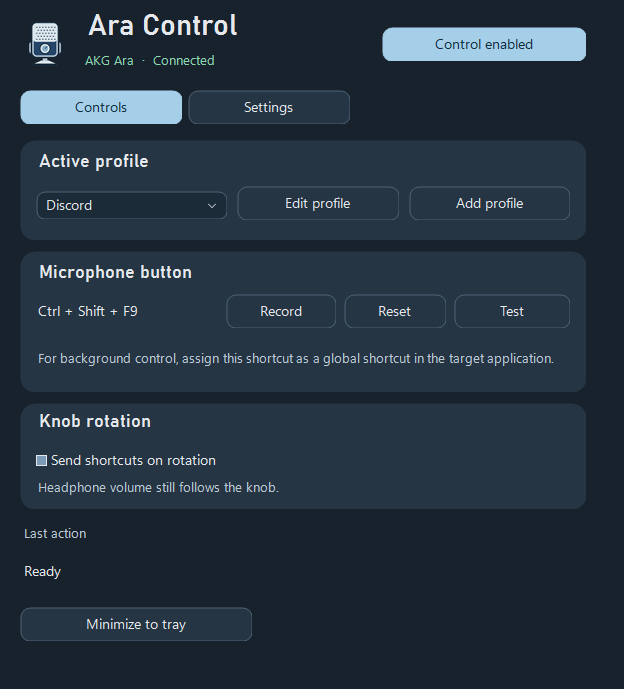
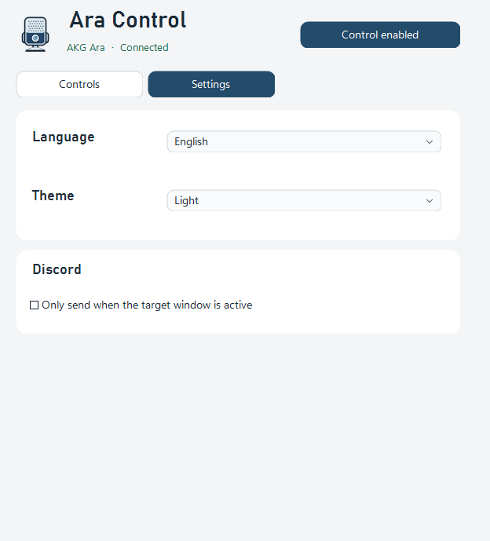

# Ara Control

Use the mute button on your AKG Ara USB microphone to deafen yourself in Discord while a game or another window is in front. Ara Control reads the button and volume knob on Windows and sends the keyboard shortcuts you choose.

[Download AraControl.exe](https://github.com/WasyaPetechkin/ara-control/releases/latest/download/AraControl.exe) · [Release notes](https://github.com/WasyaPetechkin/ara-control/releases/latest)



## Set up Discord

1. Connect the AKG Ara, download `AraControl.exe` from the release, and run it. The window should show **AKG Ara · Connected**.
2. In the **Discord desktop app**, open **User Settings → Keybinds → Add a Keybind**. Choose **Toggle Deafen** and record **Ctrl + Shift + F9**. Leave the Keybinds page when you finish.
3. In Ara Control, select the **Discord** profile. If the top button reads **Control paused**, click it to enable control.
4. Join a voice channel and press the button on the Ara. Discord deafens you, silencing the call and muting your mic. Press again to toggle deafen off.

Choose **Minimize to tray** to keep Ara Control running. Right-click the tray icon to pause control, change profiles or exit.

## Customize the controls

| Control | How it works |
| --- | --- |
| Microphone button | Choose **Record**, press your shortcut, then **Save**. **Cancel** discards the edit. **Reset** restores the profile default, which is **Ctrl + Shift + F9** for Discord. |
| Volume knob | Turning the knob keeps its normal headphone-volume function. Enable **Send shortcuts on rotation** to also send a separate shortcut in each direction. |
| Other voice apps | Choose **Add profile**, enter a name and select the app’s process. Assign the same shortcut in Ara Control and the voice app. Select the profile manually in the window or tray. |
| Window focus | For background use, give each app a unique global shortcut. To restrict a profile to the foreground, enable **Only send when the target window is active** under **Settings**. |

If a press has no effect, check **Last action**. **Test** sends the configured shortcut without pressing the microphone button. If Windows reports it was sent, try the same keys on your keyboard with the target app running.

## Compatibility

**Tested hardware** — AKG Ara USB Microphone, verified on Windows. This version recognizes the Ara’s USB HID interface (`VID_0ECB`, `PID_2057`, `MI_03`). Devices with a different USB identifier are outside the current device filter. Other microphone models have not been tested.

**Interface languages** — English, Українська and Русский. Choose a language or follow Windows. Light, dark and system themes are available under **Settings**.

<details>
<summary>View settings in light mode</summary>



</details>

## Build on Windows

Run the included PowerShell script from the source directory. It uses the Windows .NET Framework C# compiler and writes `AraControl.exe` beside the script.

```powershell
.\Build.ps1
```
