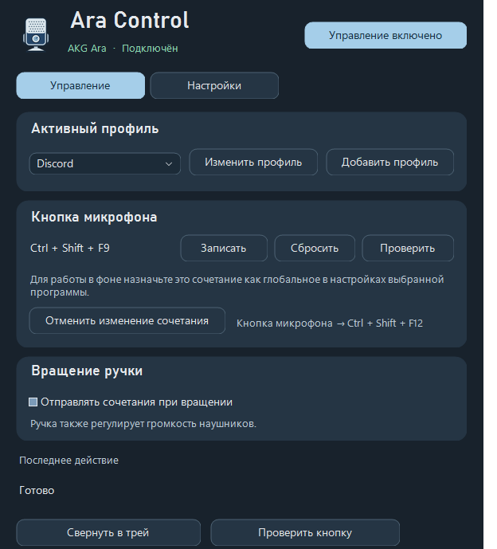
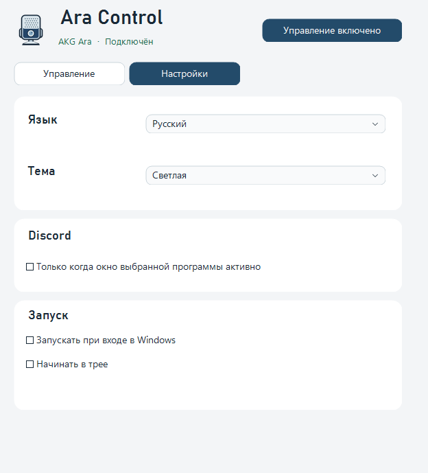

# Ara Control

[English](README.md) · **Русский**

Кнопкой на микрофоне AKG Ara можно одновременно выключить свой микрофон и звук собеседников в Discord, даже во время игры. Ara Control работает в Windows и позволяет назначить сочетания клавиш на нажатие кнопки и повороты ручки.

[Скачать AraControl.exe](https://github.com/WasyaPetechkin/ara-control/releases/latest/download/AraControl.exe) · [Последний релиз](https://github.com/WasyaPetechkin/ara-control/releases/latest)



## Быстрый старт с Discord

1. Подключите AKG Ara и запустите `AraControl.exe`. В окне появится статус **«AKG Ara · Подключён»**.
2. В настольном Discord откройте настройки пользователя и добавьте горячую клавишу. Выберите действие **«Вкл./выкл. звук в динамиках»** (*Toggle Deafen*), назначьте **Ctrl + Shift + F9** и закройте настройки Discord.
3. В Ara Control выберите профиль **Discord**. Если вверху написано **«Управление на паузе»**, нажмите эту кнопку, чтобы включить управление.
4. Войдите в голосовой канал и нажмите физическую кнопку Ara. Значок наушников в Discord станет перечёркнутым. Нажмите ещё раз, чтобы вернуть звук.

## Кнопка, ручка и профили

| Что настроить | Как это сделать |
| --- | --- |
| Кнопка микрофона | Нажмите **«Записать»**, введите сочетание и нажмите **«Сохранить»**. **«Отмена»** сохраняет прежнюю привязку. **«Сбросить»** возвращает значение по умолчанию. Для Discord это **Ctrl + Shift + F9**. |
| Ручка громкости | Вращение регулирует громкость наушников. Если включить **«Отправлять сочетания при вращении»**, каждому направлению можно дополнительно назначить свою команду. |
| Другое голосовое приложение | Нажмите **«Добавить профиль»**, укажите название и выберите процесс приложения. Назначьте одно и то же сочетание в профиле и в самом приложении. Профиль выбирается вручную в окне Ara Control или через значок в трее. |

### Если одновременно открыты Discord и Telegram

Кнопка на корпусе выключает или включает **сам микрофон** для всех приложений, которые его используют. Выбранный профиль определяет, какое сочетание Ara Control дополнительно отправит в Windows. Чтобы разные приложения не реагировали на одну команду, назначьте каждому своё глобальное сочетание.

| «Только когда окно выбранной программы активно» | Что произойдёт при нажатии |
| --- | --- |
| **Выключено** | Если выбран профиль Discord и Discord запущен, его глобальная команда может сработать и во время игры, и поверх звонка в Telegram. |
| **Включено** | Сочетание отправляется только при активном окне выбранной программы. Например, нажмите кнопку в Discord, чтобы заглушить звонок, затем перейдите в Telegram и нажмите снова. Микрофон Ara включится, а Discord останется в режиме Deafen. |

## Как проверить нажатие

На вкладке **«Управление»** нажмите **«Проверить кнопку»**, затем в течение 30 секунд нажмите кнопку на микрофоне. В окне видно, получено ли нажатие, запущена ли выбранная программа и приняла ли Windows сочетание клавиш. Если включено ограничение по активному окну, перед нажатием переключитесь в выбранную программу.

Окно проверки можно оставить открытым. Каждое повторное нажатие увеличивает счётчик и при включённом управлении снова отправляет команду. Так в Discord можно одним нажатием включить Deafen, а вторым вернуть звук. Результат виден по значку наушников в самом Discord.

Чтобы проверить только физическую кнопку, поставьте управление на паузу: счётчик продолжит работать. Для отдельной проверки горячей клавиши нажмите **«Проверить»** рядом с сочетанием на главном экране.

## Автозапуск и трей

В разделе **«Настройки → Запуск»** доступны два независимых параметра, оба по умолчанию выключены:

- **«Запускать при входе в Windows»** — утилита запускается при входе в вашу учётную запись. Перед включением положите `AraControl.exe` в папку, из которой планируете им пользоваться.
- **«Начинать в трее»** — программа запускается со скрытым окном. Выбранный профиль и состояние паузы сохраняются между запусками.

Во время работы окно можно скрыть кнопкой **«Свернуть в трей»**. Двойной щелчок по значку микрофона открывает его снова. В меню правой кнопки мыши можно сменить профиль, поставить управление на паузу или выйти из программы.

## Совместимость и языки

**Проверенный микрофон — AKG Ara USB Microphone.** Текущая версия распознаёт его USB HID-интерфейс по идентификаторам `VID_0ECB`, `PID_2057` и `MI_03`. Модели с другими идентификаторами эта версия не обнаруживает. Другие микрофоны не тестировались.

У вас другой микрофон? Укажите производителя и модель. Если есть возможность, добавьте USB-идентификатор или опишите, что происходит при нажатии кнопки mute. [Предложить микрофон для проверки](https://github.com/WasyaPetechkin/ara-control/issues/new?template=microphone-support.yml)

**Языки интерфейса:** русский, украинский и английский. В настройках можно выбрать язык вручную или использовать язык Windows. Для оформления доступны светлая, тёмная и системная темы.

<details>
<summary>Посмотреть настройки в светлой теме</summary>



</details>

## Сборка в Windows

Откройте PowerShell в папке с исходниками и выполните:

```powershell
.\Build.ps1
```

Скрипт использует компилятор C# из .NET Framework и создаёт `AraControl.exe` рядом с собой.
